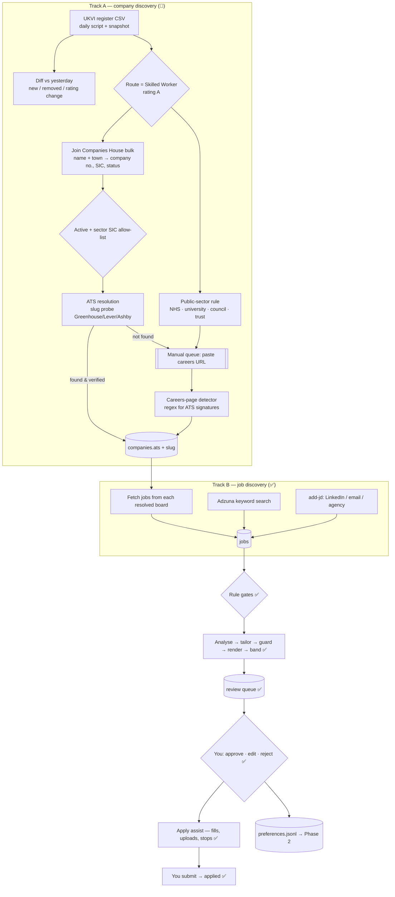

# career-ops — plan v3 (sponsor-first discovery)

Status legend: ✅ built & tested · 🔨 to build · 🧪 needs your live run · 👤 needs you

## 0. Decisions locked so far

| Decision | Why |
|---|---|
| **Two discovery tracks feed one pipeline.** Track A finds *companies* from the UKVI sponsor register; Track B pulls *jobs* from those companies' applicant-tracking systems (ATS). | A company's careers page and its Greenhouse/Lever/Ashby feed are the same inbox, so the edge isn't a different channel — it's finding sponsoring SMEs nobody adds to an aggregator search. |
| **Register is fetched by script, daily, and snapshotted.** GOV.UK email alert = optional canary only. | Email → manual CSV update puts a human step inside cron. Snapshot diffs give a "newly licensed sponsor" signal for free. |
| **Companies House via the monthly bulk file, not the API.** | API = 600 req / 5 min → 127k names × 2 calls ≈ 35 h. Bulk join ≈ minutes. API only for leftovers. |
| SQLite = state, Excel = export view. Local xelatex, no Overleaf. | (v2) |
| LLM selects/rewords from the fact bank only; deterministic guard; 70–85 % band + honest ceiling. | (v2) |
| Human reviews every application; the bot never presses Submit. | (v2) |
| Groq free tier primary, `qwen2.5:7b-instruct` local fallback. | (v2) 32B doesn't fit the 4060. |
| Preference log now; DPO/GRPO is Phase 2. | (v2) |

## 1. Architecture

## 2. Track A — company discovery (🔨 this sprint)

### A1. Register snapshots + diff — `careerops sponsors`
- Scrape the publication page for today's CSV link → download only if the link changed (the filename carries the date).
- Keep every snapshot as `data/register/YYYY-MM-DD.csv.gz` (~10 MB raw each, compresses well).
- Diff on normalised name: **added**, **removed** (licence lost → pause any open applications), **rating changed** (A → B is a warning sign).
- `companies.first_seen_on_register` powers a "new sponsors this week" view in review and the Excel export.

### A2. Sector filter via Companies House bulk data — `careerops companies --refresh-ch`
- Monthly Free Company Data Product (live companies, includes up to 4 SIC codes, no websites).
- Join key: normalised name (same normaliser as v2). Ties broken by register town == registered-office town; still ambiguous → keep all candidates, flag.
- Keep: status active **and** any SIC in the allow-list below (editable in `settings.yaml → companies.sic_allow`).

| Sector | SIC 2007 codes (descriptions verified) |
|---|---|
| Software & IT | 58290 other software publishing · 62011 · 62012 business & domestic software dev · 62020 IT consultancy · 62030 · 62090 other IT services |
| Data & platforms | 63110 data processing, hosting · 63120 web portals |
| Finance | 64191 banks · 64999 financial intermediation n.e.c. · 66190 auxiliary financial |
| Insurance | 65110 life · 65120 non-life |
| Pharma, biotech, research | 21200 pharmaceutical preparations · 72110 biotech R&D · 72190 other natural-science R&D · 72200 social-science R&D |
| Consulting | 70229 management consultancy |
| Health | 86101 hospital activities · 86900 other human health |

- **Public sector bypass.** NHS trusts, universities (Royal Charter) and councils are mostly *not* companies, so they won't join to Companies House. A name rule (`NHS|University|Council|Trust|Authority|Agency`) keeps them on a separate list. Their jobs live on NHS Jobs / Civil Service Jobs / jobs.ac.uk — a later source, not in this sprint.

### A3. ATS resolution — `careerops companies --resolve`
- **Slug probe** (no website needed). From the normalised name generate ≤4 candidates — `monzo bank` → `monzobank`, `monzo-bank`, `monzo`, `monzo-bank-ltd` — and try each against the Greenhouse, Lever (+EU) and Ashby public APIs. 404 = not there.
- **Verification** (a short slug can belong to someone else): accept only if the board's company name matches (Greenhouse returns `company_name`), *or* ≥1 job is located in the UK *and* the slug equals the full normalised name. Otherwise → `probe_unverified`, shown to you.
- **Budget:** ≤ 4 slugs × 4 endpoints = 16 calls/company at 1 req/s → about 270 companies/hour. Probe each company once; re-probe misses monthly.
- **Manual queue:** unresolved companies are listed (largest/newest sponsors first); you paste a careers URL; the **detector** fetches it once and looks for ATS signatures: `boards.greenhouse.io`, `job-boards.greenhouse.io`, `jobs.lever.co`, `jobs.ashbyhq.com`, `myworkdayjobs.com`, `smartrecruiters.com`, `apply.workable.com`, `teamtailor.com`, `recruitee.com`, `pinpointhq.com`, `bamboohr.com`.
- Greenhouse / Lever / Ashby → fetched automatically by Track B. Any other ATS → `careers_url` stored, jobs added with `add-jd` until a fetcher for it is worth writing (decide by count after the first run).

### A4. New table `companies`
`norm, register_name, town, rating, route, first_seen_on_register, last_seen_on_register, ch_number, ch_name, sic_codes, sector, ch_match (exact|town|ambiguous|none), public_sector, ats, ats_slug, ats_verified, careers_url, probe_status, last_probed`

`discover` then reads boards from **settings.yaml ∪ companies table**.

## 3. Track B + shared pipeline (✅ built, 28 tests)
Unchanged from v2: Greenhouse/Lever/Ashby/Adzuna fetchers · rule gates (title, seniority, location, no-sponsorship, SRE, line management, clearance, years) · JD keyword analysis (taxonomy + verbatim-checked LLM keywords) · honest ceiling · fact-bank tailoring with faithfulness guard · xelatex 2-page render, no hyphenation · band loop with de-stuffing and no-progress stop · cover letter rules · review CLI with edit → DPO pairs · Playwright assist that never submits · Excel export · cron example.

## 4. Milestones

| # | Milestone | Done when | Owner | Status |
|---|---|---|---|---|
| M0 | v2 pipeline | 28 tests pass, mock end-to-end produces a 2-page CV | me | ✅ |
| M1 | Register snapshots + diff | two fixture snapshots → correct added/removed/rating-changed; idempotent re-run | me | 🔨 |
| M2 | Companies House bulk join + sector filter | fixture bulk file joins with exact/town/ambiguous cases; public-sector rule separates NHS/university rows | me | 🔨 |
| M3 | ATS slug probe + verification + detector | mocked APIs: true hit verified, slug collision rejected, 404s handled; detector finds each ATS signature in fixture HTML | me | 🔨 |
| M4 | Wire into `discover` + Excel "Companies" sheet + "new sponsors" view | `careerops run --mock` uses resolved boards | me | 🔨 |
| M5 | First live run on your machine | register + CH files download; ≥1 real board resolved; 5 real JDs tailored with Groq | you + me | 🧪👤 |
| M6 | Calibrate | review 20 real outputs; tune gates, prompts, fact-bank `terms`; record guard-block rate | you + me | 🧪👤 |
| M7 | Phase 2 | ≥200 edit pairs → DPO trial; GRPO only if a GPU budget exists | later | — |

## 5. What I need from you (👤)
1. **Fact bank TODOs** — surname, contact details, LinkedIn/GitHub URLs, B.E. institution and dates, certifications.
2. **Evidence for current "genuine gaps"** — *prompt engineering*, *CI/CD*, *large language models* (wording), *end-to-end*: which bullet backs each, if any.
3. **Groq API key** in `.env` on your machine (never pasted into chat).
4. **Your 80-company tracker** (export the Google Sheet) — seeds Track A's verified boards and doubles as a test set for the slug probe.

## 6. Open decisions — defaults I'll use unless you say otherwise
| Question | Default |
|---|---|
| Keep B-rated sponsors? | No — A-rated only (B means the Home Office has compliance concerns) |
| Sector allow-list | The table above (software, data, finance, insurance, pharma/biotech/R&D, consulting, health) |
| Locations | UK-wide + remote-UK; no Bristol-only filter |
| Tailoring cap per cron run | 25 jobs (≈ one review sitting) |
| Re-probe unresolved companies | Monthly |

## 7. Risks
- **Name-join noise** between the register and Companies House (trading names, renamed firms) → ambiguous matches are flagged, never silently picked.
- **Slug collisions** (`apex` belongs to someone else) → verification rule; unverified hits need your click.
- **Long tail of ATSs** (Workday etc.) → manual queue; build fetchers only where counts justify them.
- **Free-tier drift** (Groq models/caps change) → router falls through to local; check the console monthly.
- **GOV.UK page layout change** breaks CSV-link scraping → the run fails loudly; the email alert is your backup signal.

## 8. Verified vs to verify on first live run
- Verified: register publishes CSV with name/town/county/rating/route and updates ~daily; Companies House bulk product is monthly, live companies, includes SIC; CH API is 600 req / 5 min and has no websites; SIC descriptions in §A2; Greenhouse/Lever public APIs.
- To verify (🧪): exact bulk-file column names; Ashby response fields; Workable/SmartRecruiters public endpoints (only if the manual queue shows enough of them).
